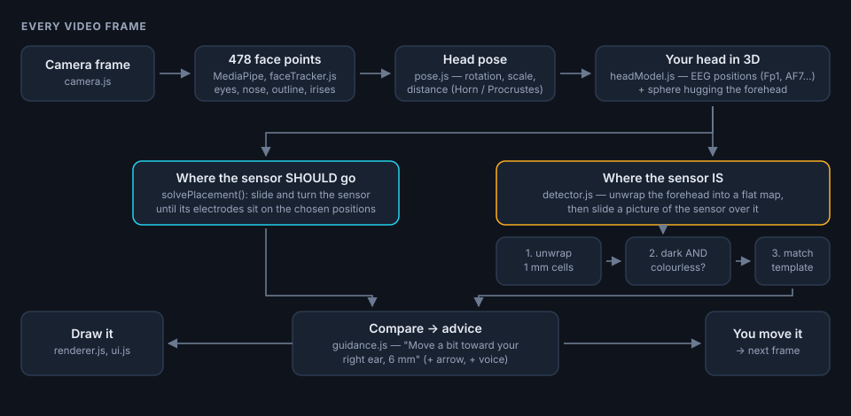

# How this app works, file by file

This assumes you can read Python and are comfortable with basic geometry; the JavaScript
specifics are explained as they come up (there is a short JS-for-Python-people section at
the end).



---

## 0. The thirty-second version

The camera only ever sees your **face**. EEG positions (Fp1, AF7, F7…) are defined on the
whole **head**, with a tape measure. So the app does this, 15–30 times per second:

1. MediaPipe finds 478 points on your face.
2. We compute how the head is turned and how big it looks (`pose.js`).
3. That lets us put a 3D model of a head — with its EEG positions — exactly on your face
   (`headModel.js`, built once by `tools/build_head_model.py`).
4. We work out where your sensor should sit so its electrodes land on the positions you
   chose (`solvePlacement`).
5. We flatten the forehead into a millimetre map and look for the real sensor on it
   (`detector.js`).
6. The difference between 4 and 5 becomes "move a bit toward your right ear"
   (`guidance.js`), plus an arrow drawn on the video (`renderer.js`).

---

## 1. Four coordinate systems (the thing to get straight)

Most of the code is just moving between these four. Keep them apart and everything else
is easy.

| Name | Units | Origin / axes | Used by |
|---|---|---|---|
| **Image** | pixels | top-left of the camera frame, x right, y **down**, z away from camera | MediaPipe output, drawing |
| **Head frame** | mm | **nasion** (the dip of the nose bridge between the eyes); x = subject's **left**, y = up, z = out of the face | EEG positions, the sphere, everything 3D |
| **Forehead map (u, v)** | mm *on the skin* | middle of the forehead; u = sideways (+ = toward the left ear), v = up | sensor placement, detection, advice |
| **Sensor (s, t)** | mm | centre of the pod; s = along the strips (+ = toward the left ear), t = up | the sensor's own shape |

Two notes that save a lot of confusion:

* **"Left" always means the subject's left.** EEG numbering agrees: odd numbers (Fp1, F7)
  are on the left of the head, even numbers (Fp2, F8) on the right. The *screen* side
  depends on the camera and is decided in exactly one place (`guidance.js`, `renderer.js`).
* The head frame is **not mirrored, ever**. Mirroring is only a drawing decision.

---

## 2. Background: what the 10-20 system actually says

Electrode names are not "somewhere on the forehead"; they are proportions of *your* head:

* Measure nasion → inion (the bump at the back of the skull) over the top. **Fpz** is at
  10 % of that distance above the nasion (≈ 3.5 cm on an adult).
* Measure around the head through Fpz. Going sideways from Fpz along that circle:
  **Fp1/Fp2** at 5 % of the circumference, **AF7/AF8** at 10 %, **F7/F8** at 15 %.

So all of Fp1, Fpz, Fp2, AF7, AF8, F7, F8 lie on **one line around the head** — the dashed
line the app draws. That is why a straight sensor band can reach several of them, and why
the app cares so much about a "straight line on the skin".

The app does not re-derive these percentages at runtime. It uses a published table of
positions measured on a template head, and fits that head to your face (next section).

---

## 3. The head model — `tools/build_head_model.py` → `js/headModelData.js`

Run once (`python tools/build_head_model.py`); the app only reads the generated JS file.
It merges two public datasets, both in `tools/data/`:

* `canonical_face_model.obj` — MediaPipe's average face: the 468 landmarks in 3D, in cm.
* `standard_1005.elc` — the standard 10-05 electrode positions on the MNI template head
  (Oostenveld & Praamstra 2001, via FieldTrip), in mm.

The job is to express both in **one** coordinate system. Four steps:

**a. Axes.** MNI uses (x = right, y = front, z = up); our head frame uses (x = left,
y = up, z = front). So `(x, y, z) → (-x, z, y)`.

**b. Size.** The template head is big: measuring along the 10 % line through its
electrodes gives **609.5 mm** around. We shrink it to an average adult head, 560 mm
(`AVERAGE_HEAD_CIRCUMFERENCE`), a factor of **0.9187**.

**c. Origin.** Put the template's nasion `Nz` on MediaPipe's landmark **168**, which is the
deepest point of the nose bridge — the real nasion. (Verified by printing the midline of
the canonical face: 168 has the smallest z of the forehead/nose midline chain.)

**d. Tilt.** The two models are not nodding the same way, and nobody documents by how
much. So we measure it: rotate the EEG head around the ear-to-ear axis, and for each angle
check how far the forehead electrodes (Fpz, Fp1, Fp2, AFp…) end up from the face's
forehead *skin* (`face_depth_at` shoots a ray at the face mesh and interpolates the
triangle it hits). The best angle is **−7.04°**, and at that angle the electrodes sit on
the skin to **1.02 mm RMS** — a reassuringly good fit for two models built by different
people from different data.

A sanity check falls out of it: the template's ear point (LPA) then lands 19 mm below and
97 mm behind the nasion, which is where a real tragus is.

Then the script:

* makes left/right perfectly symmetric (the template is ~1 mm asymmetric),
* fits a **sphere to the forehead** — using the frontal electrode rows plus the forehead
  vertices of the face mesh. Result: centre 25 mm above and 76 mm behind the nasion,
  radius **75.1 mm**, fitting to **1.70 mm RMS**. This sphere is what the sensor is draped
  on and what gets "unwrapped" for detection.
* writes `js/headModelData.js`: the 29 tracking landmarks (with MediaPipe's own weights),
  13 EEG positions, and the sphere.

> **Why 29 landmarks and not MediaPipe's 33?** MediaPipe's list includes four points on
> the jaw (136, 365, 132, 361). The jaw moves when you talk, which would make the whole
> overlay wobble, so `JAW_LANDMARKS` drops them.

---

## 4. Following the head — `js/pose.js`

Input: the 478 landmarks. Output: a `pose` that maps *head frame mm* → *image pixels*.

```js
return { R, s, modelCenter, imageCenter, distanceMm, rmsPx, irisPx, width, height };
```

### Smoothing first

Every landmark coordinate goes through a **One Euro filter** (`math3d.js`). It is an
exponential moving average whose strength depends on speed: still head → heavy smoothing
(no jitter); fast head → light smoothing (no lag). Two parameters: `minCutoff = 1.5 Hz`,
`beta = 0.02`.

### The fit (Procrustes, solved with Horn's method)

We want the rotation `R` and scale `s` that best place the model face onto the seen face,
minimising the weighted sum of squared distances. The classic closed-form solution:

1. Move both point sets to their weighted centres.
2. Build the 3×3 cross-covariance `S = Σ wᵢ · Pᵢ Qᵢᵀ` (model × seen).
3. Build a specific symmetric **4×4 matrix** from `S` (Horn 1987). Its eigenvector with
   the largest eigenvalue *is* the best rotation, written as a quaternion.
4. `s = Σ wᵢ Qᵢ·(R Pᵢ) / Σ wᵢ |Pᵢ|²`.

The eigenvector comes from `symmetricEigen` (Jacobi rotations, `math3d.js`). Using a
quaternion is not decoration: it cannot accidentally produce a mirrored "rotation", which
a naive 3×3 solution can.

`rmsPx` (how well the model matched) is kept as a quality number, shown in Settings.

### Perspective

The fit is "weak perspective": it assumes everything is at the same distance. That is
wrong for points far behind the face plane — F7/F8 sit ~4 cm back, and at 30 cm from the
camera that is a ~6 mm error. So `projectPoint` scales each point by how far behind the
face centre it is:

```js
const r = matVec(pose.R, sub(p, pose.modelCenter));   // mm, camera axes
const m = pose.distanceMm / (pose.distanceMm + r[2]); // farther = smaller
x = pose.imageCenter[0] + pose.s * m * r[0];
```

`distanceMm` comes from the focal length: `focalPx = (longest side / 2) / tan(fov/2)`,
with an assumed field of view (`CAMERA.fovLongSideDeg = 68`, typical for phones) — then
`distance = focalPx / s`. If that assumption is 20 % off, the correction is 20 % off,
which is still far better than ignoring perspective.

### How big is this face, really? (the iris trick)

The pose gives pixels-per-*model*-mm, not real mm: a big face nearby and a small face
close up look the same. The visible **iris is 11.7 mm wide in virtually every adult**
(this is how MediaPipe's own depth estimation works), so:

```
real mm per model mm  =  pose.s × 11.7 / (iris diameter in pixels)
```

`irisDiameterPx` takes the larger of the two diameters of each iris (a turned head squashes
one of them) and refuses the measurement when the two eyes disagree by more than 30 %
(blink, extreme angle). `main.js` keeps a **rolling median of 45 frames** of it, because
this number must be stable, not fast.

It is used for two things: printing distances in real millimetres, and — if you type your
head circumference into Settings — scaling the whole head model (`head.setScale`).

---

## 5. The forehead map and draping — `js/headModel.js`

### The map (u, v)

```js
chartPoint(u, v) {  // (u, v) in mm on the skin -> 3D point
  const a = u / this.radius, b = v / this.radius;
  return centre + radius * [sin a, sin b · cos a, cos b · cos a];
}
```

Read it as: *walk `v` mm up the middle of the forehead, then `u` mm sideways.* Both walks
follow the shortest path on the sphere.

**This choice matters, and the first version got it wrong.** The obvious map (longitude ×
latitude) makes a straight strip look like a banana: a flexible band pressed horizontally
on a round forehead follows a great circle, which drifts ~6 mm away from the latitude line
at the ends. With that map the detector could not match a straight template, so it tilted
the template instead and reported a 12° tilt on a perfectly level sensor. With the map
above, horizontal lines *are* those great circles, so a straight strip stays straight.
The unit test `head: a straight strip stays straight on the map` locks this in.

### Draping

`drape(placement, s, t)` puts the point `(s, t)` of the flat sensor onto the head. It
walks `√(s² + t²)` mm along the skin from the sensor centre, in the direction given by
`(s, t)` and the rotation `psi`. On a sphere that is one rotation (the "exponential map"),
so distances from the centre are exact — the same thing that happens when you press a
sticker down from its middle outward.

Also here: `toChart` (3D → map), `frameAt` (the east/north/outward directions at a point),
`skinDistance` (distance along the skin), `nearestPosition`.

---

## 6. Where the sensor should go — `solvePlacement`

A placement is three numbers: `{ u, v, psi }`.

* **"Pod centred on Fpz"** → trivially the map coordinates of Fpz, level.
* **"Electrodes on Fp1–Fp2"** → minimise

  ```
  cost(u, v, psi) = |left electrode − Fp1|² + |right electrode − Fp2|²
  ```

  starting from "halfway between the targets, pointing from one to the other", then a
  **pattern search**: try ±2 mm and ±2°, keep anything that lowers the cost, halve the
  steps when nothing does, stop at 0.01 mm. A few hundred evaluations, once — not per
  frame. It is 20 lines and has no failure modes, unlike a gradient method on a sphere.

`describePlacement` then reports, for each electrode, where it lands, how far that is from
its target, and which EEG position is closest. `main.js` turns this into the line under the
target menu — including the honest warning when your sensor simply cannot reach:

> ⚠ Your electrodes are 68 mm apart, but Fp1–Fp2 are 46 mm apart on this head: each
> electrode stays about 11 mm away.

---

## 7. The sensor's shape — `js/sensor.js`

`buildSensor(cfg, toModel)` turns six measurements (Settings) into:

* **outlines** for drawing: `pod` (rounded rectangle), `strips` (two quadrilaterals,
  sampled every 2 mm so they bend nicely when draped), `patch` (the adhesive), `led`;
* **electrodes**: `{left: {s, t}, right: {s, t}}`;
* a **template** for the detector: lists of sample points in four groups — `pod`,
  `stripLeft`, `stripRight` (inside the dark parts) and `ring` (the skin just around the
  sensor, 4 mm out).

`toModel` is `1 / (real mm per model mm)`: the sensor has a fixed real size, so on a big
face it covers relatively less of the head.

Defaults come from measuring the CLIC sensor **through the app itself** — the unwrapped
map is in millimetres, so reading the sensor off it gives: pod ≈ 33 × 16 mm, strips ≈ 36 mm
long and 7 mm wide, dark area from 14 mm to 50 mm out from the centre. The electrode
distance defaults to 34 mm (the middle of the fabric strip, assuming the whole strip is
the electrode). **If your sensor differs, change these numbers — everything else follows.**

---

## 8. Finding the real sensor — `js/detector.js`

The hardest part, and the reason for the unwrapping.

### a. Unwrap (`unwrap`)

A grid of 1 mm cells covering the forehead (from 16 mm to 80 mm above the nasion, ±72 mm
sideways: `DETECTION` in `config.js`). Each cell knows its 3D point and its outward normal
(computed once per head size). Every frame we project all of them into the image and read
the pixel there. Cells whose skin faces away from the camera, or fall outside the frame,
are marked invisible.

The result is a picture of the forehead **in millimetres**, the same whatever the head
does — so the search needs no scaling or rotation of the image.

### b. Sensor-likeness (`computeLikeness`)

Per cell, a number from 0 to 1, the product of two tests:

* **dark**: compared with the skin brightness *of its own column* (the 65th percentile of
  the column, smoothed sideways) — so uneven lighting does not matter;
* **colourless**: the sensor is black/grey; skin, brown hair and eyebrows are strongly
  coloured. Measured as chroma ÷ brightness relative to this person's skin.

Measured on the CLIC photo: pod brightness 41 with chroma 5; strips 51–56 / 15; brown hair
55 / **68**; eyebrows 87 / 67; skin 157 / 85. Hair is exactly as dark as the sensor, and
the colour test is what separates them. (Black hair is *not* separated this way — the
shape test below has to do that work.)

### c. Template match (`findSensor`)

Slide the template over the map and score:

```
strips = 0.7 · min(left, right) + 0.3 · mean(left, right)
total  = 0.6 · pod + 0.4 · strips − 0.6 · ring − 0.001 · |angle in degrees|
```

* The **ring** term is what rejects hair and the eyebrows: a big dark area scores well
  inside the template *and* in the ring, so it loses.
* `min(left, right)` insists that **both** strips match. A wrong tilt fits one strip and
  misses the other — this term is what killed the false "tilted by 12°" readings.
* The angle penalty is a tiny nudge that breaks ties in favour of a level sensor.

Two passes for speed: a coarse one every 2 mm and 4°, with a quick rejection when the pod
area is not dark enough (most of the forehead is rejected in a few operations), then the
same pattern search as the placement solver, down to 0.2 mm, reading the map with
bilinear interpolation.

Finally a light average with the previous frame (and up to 8 frames of "keep showing the
last one" when a frame fails), so the outline does not flicker.

### What it looks like

Turn on *Settings → Show the unwrapped forehead* to see exactly this: the flattened
forehead, the magenta "looks like the sensor" tint, the amber outline where it was found
and the cyan one where it should go.

---

## 9. Advice — `js/guidance.js`

```js
du = (detected.u − target.u) × realMm   // + : too far toward the LEFT ear
dv = (detected.v − target.v) × realMm   // + : too high
dpsi = detected.psi − target.psi        // + : the LEFT-ear end is too high
```

Each axis over its tolerance (3 mm, 3 mm, 4°) becomes a correction with a plain sentence,
a millimetre amount and an arrow; they are sorted by how bad they are and the worst one is
shown big. When all are inside tolerance and stay there for 0.7 s, `Coach` upgrades the
message to "Perfect - press it down gently". `Coach` also speaks (throttled to one phrase
every 2.5 s, or 6 s if it is the same one).

### The mirror question

Instructions are anatomical ("toward the right ear"), so they are correct for you and for
someone standing in front of you. Only the little arrow flips:

```js
arrow: (du > 0) === selfie ? '→' : '←'
```

With the selfie camera the picture is mirrored, so your right ear is on the right of the
screen. With the back camera you are looking at someone's face, so their right ear is on
the left of the screen. The big arrows drawn on the video have no such problem: they are
drawn from where the sensor is to where it should be, so they are right by construction.

---

## 10. Drawing and interface

**`js/renderer.js`** draws the video and all overlays.

* `beginFrame` sizes the canvas to the video, draws the frame mirrored if needed, then
  resets the transform. Overlays are drawn **unmirrored**, converting each point with
  `toScreen` — otherwise every label would read backwards.
* `drawPositions` draws the dashed 10 % line (walking along the sphere between positions),
  the dots and labels (hidden when they rotate to the far side of the head: a point is
  drawn only if its outward normal still faces the camera), and the nasion cross.
* `drawSensor` drapes every outline point and fills it. Four styles: `solid` (preview),
  `target` (cyan dashed), `found` (amber), `aligned` (green).
* `drawGuidance` draws the arrow from the detected centre to the target centre, and for a
  tilt, arrows at both strip ends comparing *the same centre* with the target angle, so it
  shows rotation only.
* `drawUnwrapped` is the debug inset described above.
* All sizes are multiples of `unit = min(width, height) / 100`, so it looks the same on a
  phone and on a laptop.

**`js/ui.js`** owns the DOM and the settings (saved in `localStorage`, wrapped in
try/catch because private mode can forbid it). `ui.preset` returns the chosen target.

**`js/main.js`** is the loop, and reads as the list of steps in section 0. Two details:

* the placement is only recomputed when something changed (a `sizeKey` string of the
  sensor settings, the target, the face size and the head scale);
* `window.app` exposes the state for the browser console and for the automated tests.

---

## 11. The toolbox — `js/math3d.js`

Vectors as plain arrays, 3×3 matrices as 9 numbers, plus:

* `quatToMatrix` — quaternion → rotation matrix.
* `symmetricEigen` — Jacobi eigenvalues for small symmetric matrices: repeatedly apply
  tiny rotations that each cancel one off-diagonal entry until the matrix is diagonal.
  Used for Horn's 4×4. ~40 lines, no dependencies.
* `OneEuroFilter` — the adaptive smoother described in section 4.
* `RollingMedian` — median of the last N values, for the face-size estimate.

## 12. `serve.py`

A static file server with three fixes: correct MIME types (Windows sometimes registers
`.js` as `text/plain`, which makes browsers refuse JavaScript modules), `Cache-Control:
no-store` so edits show up on reload, and a self-signed HTTPS certificate (via
`cryptography`) for the phone, valid for `localhost` and for your LAN address.

---

## 13. Tests, and what was actually measured

**Maths** — `http://localhost:8000/tests/unit.html` (22 checks): the eigen solver against
known answers; the pose fit recovering a rotation/scale it was given (error 5·10⁻¹⁶);
perspective pulling far points inward; the map round-trip; draping preserving distances;
straight strips staying straight (10⁻¹⁴ mm); the solver hitting Fp1/Fp2 to 0.01 mm when
the sensor fits.

**The whole app** was run in Chrome against the CLIC photo as a fake camera:

| Situation | Result |
|---|---|
| Straight on | sensor found, match 0.85, tilt 0.0°, ~1 mm from where it is |
| Head tilted 12° | same position in head coordinates (u 1.5, v 39.0) |
| Face 40 % smaller, off-centre | same (u 0.7, v 41.2) |
| Moving head | same (u 5.0, v 41.1) |
| Forehead with the sensor removed | correctly reports "sensor not found" |
| Sensor pasted where the app asked | "Perfect", 0.6 mm and 1.0 mm off |

The second, third and fourth rows are the important ones: the answer does not depend on
how you hold the phone.

---

## 14. Recipes

**Your sensor is a different shape** → Settings, or change `DEFAULT_SENSOR` in
`js/config.js`. If the electrodes are at the strip *tips* rather than the middle, set
*Centre → electrode* to the distance to the tip.

**Add a montage** → one line in `PLACEMENTS` (`js/config.js`):
`{ id: 'AF3-AF4', label: 'Electrodes on AF3 – AF4', left: 'AF3', right: 'AF4' }`.
Only positions present in `HEAD_MODEL.eeg` work; to add more, put their names in
`EXPORTED_POSITIONS` in `tools/build_head_model.py` and re-run it (any 10-05 name from
`standard_1005.elc` is available — AFp1, F5, FT7…).

**Stricter or looser "Perfect"** → `GUIDANCE.goodMm`, `goodDeg`, `holdMs`.

**Detection too eager / too shy** → `DETECTION.minScore` (0.33). Watch the actual score in
Settings → diagnostics, with the unwrapped view on.

**A white or metallic sensor** → the "dark" test in `computeLikeness` is the wrong test
for that; you would invert it (bright compared with skin) or match on shape alone.

---

## 15. Limits (worth knowing before trusting it)

* **An average head is assumed.** The EEG positions come from a template scaled to your
  face (or to the circumference you type in). Individual skulls differ by a few mm; the app
  cannot see the back of your head, where the nasion→inion measurement really ends.
* **The iris trick assumes an adult iris** (11.7 mm). On a mannequin, or a child, the real
  millimetre numbers will be off by a few percent — the *positions* are unaffected.
* **Black hair on the forehead** defeats the colour test; only shape then separates it.
* **Perspective** uses an assumed field of view, so very close shots are slightly off.
* Strong head turns (past ~35°) make one strip face away from the camera and detection
  degrades; the app keeps the last good reading for 8 frames, then says it lost the sensor.

---

## 16. JavaScript notes, if you mostly write Python

| Python | Here |
|---|---|
| `import numpy as np` | `import { Head } from './headModel.js'` — the path and `.js` are required |
| `def f(a, b=1):` | `function f(a, b = 1) {}` or `const f = (a, b = 1) => …` |
| list comprehension | `array.map(x => …)`, `.filter(…)`, `.reduce(…)` |
| `dict` | object `{key: value}`; `Object.entries(obj)` to loop over it |
| `np.array` of floats | `Float32Array` (fixed size, fast — used for the forehead map) |
| f-string | template string: `` `${fps} fps` `` |
| `None` | `null` (or `undefined`); `a ?? b` = "a unless it is null" |
| `self` | `this` |
| a `while True` loop | `requestAnimationFrame(loop)`: the browser calls you back before each screen refresh |
| `async def` / `await` | the same words, same idea |

Everything is a plain **ES module** loaded straight by the browser: no build step, no
bundler, no `npm install`. Edit a file, reload the page.
