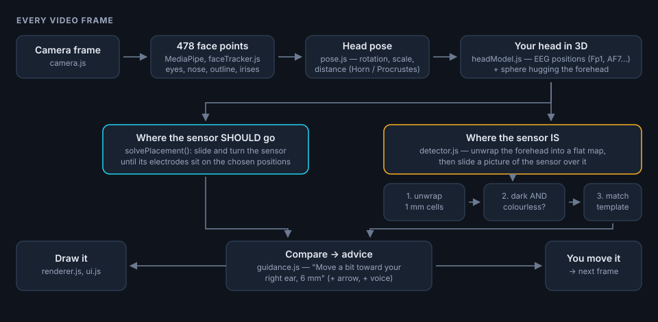

# Forehead sensor placement guide

A camera app that shows **where to stick your EEG forehead sensor** (Fp1–Fp2, AF7–AF8,
F7–F8, …), draws the sensor on your face, finds the real one and tells you how to move it:
*"Move a bit toward your right ear, 6 mm"*.

It runs in the browser (phone or computer), works with the selfie camera and the back
camera, and never sends the video anywhere: everything is computed on the device.



## Run it

```bash
python serve.py
```

* **On this computer** → <http://localhost:8000>
* **On your phone** (same Wi-Fi) → `https://<your computer's IP>:8443`, shown by the script.
  Your phone will warn that the certificate is not trusted (it is self-made): tap
  *Advanced → Proceed* (Safari: *Show details → visit this website*). Browsers only give
  camera access to `https://` pages, which is why the phone needs this.

Then tap **Start camera**.

## Using it

| Control | What it does |
|---|---|
| **Target** (top) | Which EEG positions the two electrodes should sit on. *Custom pair…* lets you pick any two. |
| Line under it | Whether your sensor can actually reach them, and how far off it will be. |
| **camera** | Switch between selfie camera and back camera (for placing it on someone else). |
| **guiding / preview** | *guiding*: find the real sensor and give directions. *preview*: just show where it goes. |
| **voice** | Say the instructions out loud (useful when you cannot see the screen). |
| **settings** | Your sensor's measurements, your head circumference, display options. |

Colours: **cyan** = where the sensor should go, **amber** = where it is now,
**green** = aligned.

### Get good results

* Pull hair off the forehead; take off glasses.
* Even lighting, no strong backlight.
* Measure your sensor once (Settings → *Your sensor*) — the defaults come from the photo
  of the CLIC sensor: pod 33 × 16 mm, strips 36 mm long and 7 mm wide, electrode centre
  34 mm from the middle.
* For the best accuracy, measure your head circumference with a tape (around the head,
  just above the eyebrows and ears) and type it in Settings. Otherwise the app estimates
  it from your face.

## What is in the folder

```
index.html            the page
css/style.css         the look
js/                   the app, one file per job (see GUIDE.md)
models/               the face-tracking neural network (3.6 MB, downloaded from Google)
tools/build_head_model.py   builds js/headModelData.js from public anatomical data
tools/data/           those public data files
tests/unit.html       maths tests: open http://localhost:8000/tests/unit.html
serve.py              the little web server above
GUIDE.md              how all of it works, file by file
```

## How exact is it?

The 10-20 positions are computed from your face with an average head model, so expect a
few millimetres of error — about the same as a trained person placing electrodes by eye,
and much better than guessing. Tested on the CLIC sensor photo: the app finds the sensor
to ~1 mm and keeps the same answer when the head tilts 12°, moves off-centre or fills half
the frame. It cannot know your skull's exact shape: for research-grade placement, still
measure with a tape.

Read **[GUIDE.md](GUIDE.md)** for how every part works.
